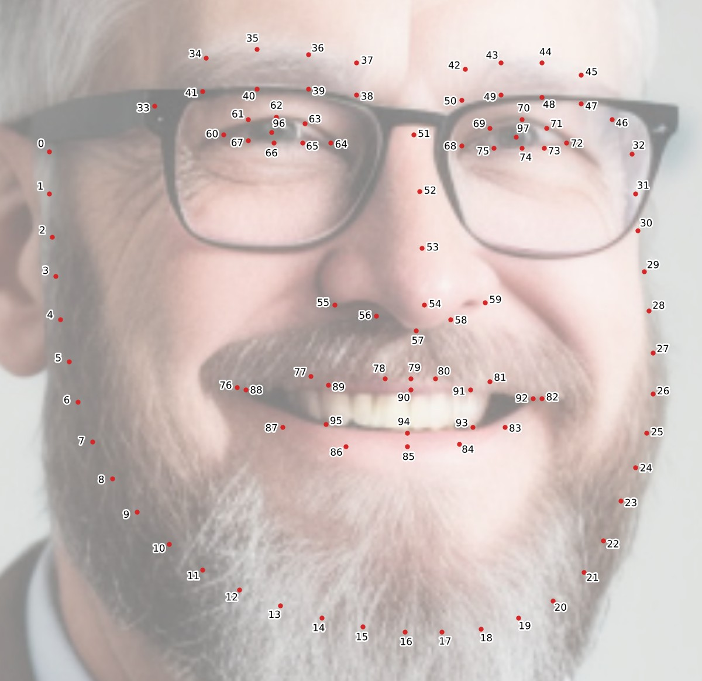

# Landmarks

## Frontal landmarks

[SPIGA](https://doi.org/10.48550/arXiv.2210.07233) places 98 landmarks on a frontal face, in the layout of the WFLW dataset ([Wu et al., 2018](https://doi.org/10.48550/arXiv.1805.10483)). Every frontal measure is calculated from them.

<figure markdown="span">
  [{ loading=lazy }](../assets/landmarks.jpg)
  <figcaption>Select the figure to open it at full size.</figcaption>
</figure>

| Landmarks | Where |
|---|---|
| 0–32 | Outline of the face, from the subject's right side, around the chin, to the left side |
| 33–41 | Subject's right brow: 33–37 along the top, starting at the outer end, and 38–41 along the bottom |
| 42–50 | Subject's left brow: 42–46 along the top, starting at the inner end, and 47–50 along the bottom |
| 51–54 | Bridge of the nose, from top to bottom |
| 55–59 | Base of the nose, from the subject's right to left |
| 60–67 | Subject's right eye: 60 is the outer corner and 64 the inner corner |
| 68–75 | Subject's left eye: 68 is the inner corner and 72 the outer corner |
| 76–87 | Outer edge of the lips: 76 and 82 are the corners, and 85 the middle of the lower lip |
| 88–95 | Inner edge of the lips: 88 and 92 are the corners |
| 96, 97 | The subject's right and left pupils |

In code, `face.landmarks` holds the 98 points as (x, y) pixels in the [standard image](units.md#the-standard-image), numbered from 0 as in the figure:

```python
x, y = face.landmarks[64]  # the inner corner of the subject's right eye
```

The [Landmarks measure](../measures.md#landmarks) returns the same points numbered from 1, as `landmark-1-x` to `landmark-98-y`. `face.draw_landmarks()` draws them on the image; pass `only=[64, 68]` to draw just those.

## Profile landmarks

For a profile, [U²-Net](https://doi.org/10.1016/j.patcog.2020.107404) removes the background, and Dynaface traces the outline of the face from forehead to chin and finds six points on it:

| | Landmark | Definition |
|---|---|---|
| 0 | Soft tissue glabella | The most prominent midline point on the forehead, above the nasion |
| 1 | Soft tissue nasion | The deepest midline point between the forehead and the bridge of the nose |
| 2 | Nasal tip | The most forward point of the nose |
| 3 | Subnasal point | Where the base of the nose meets the upper lip |
| 4 | Mentolabial point | The deepest point between the lower lip and the chin |
| 5 | Soft tissue pogonion | The most forward point of the chin |

<figure markdown="span">
  { width="480" loading=lazy }
  <figcaption>The traced outline, on the right, with the six points marked.</figcaption>
</figure>

`face.lateral_landmarks` holds the six points in this order, as (x, y) pixels in the profile image. A point Dynaface couldn't find has a y of −1, and the measures that use it are NaN. `face.sagittal_x` and `face.sagittal_y` hold the traced outline itself, one point for each row of the image that it crosses.
