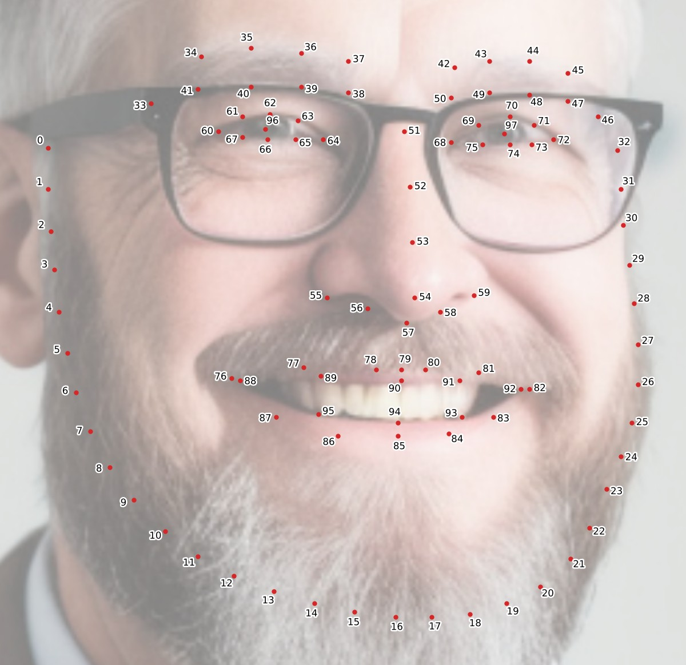
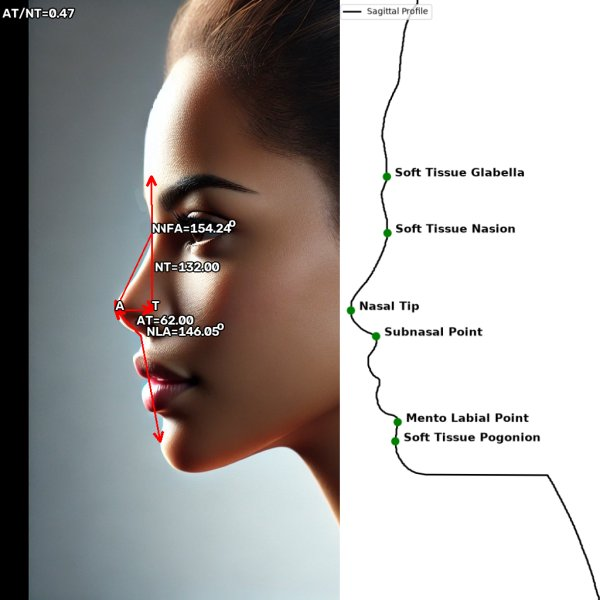

# Landmarks

## Frontal landmarks

[SPIGA](https://doi.org/10.48550/arXiv.2210.07233) places 98 landmarks on a frontal face, in the layout of the WFLW dataset ([Wu et al., 2018](https://doi.org/10.48550/arXiv.1805.10483)). Every frontal measure is calculated from them.

<figure markdown="span">
  [{ loading=lazy }](../assets/landmarks.jpg)
  <figcaption>Select the figure to open it at full size.</figcaption>
</figure>

| Landmarks | Where |
|---|---|
| 0–32 | Outline of the face, from the subject's right side, around the chin, to the left side |
| 33–41 | Subject's right brow: 33–37 along the top, starting at the outer end, and 38–41 along the bottom |
| 42–50 | Subject's left brow: 42–46 along the top, starting at the inner end, and 47–50 along the bottom |
| 51–54 | Bridge of the nose, from top to bottom |
| 55–59 | Base of the nose, from the subject's right to left |
| 60–67 | Subject's right eye: 60 is the outer corner and 64 the inner corner |
| 68–75 | Subject's left eye: 68 is the inner corner and 72 the outer corner |
| 76–87 | Outer edge of the lips: 76 and 82 are the corners, and 85 the middle of the lower lip |
| 88–95 | Inner edge of the lips: 88 and 92 are the corners |
| 96, 97 | The subject's right and left pupils |

In code, `face.landmarks` holds the 98 points as (x, y) pixels in the [standard image](units.md#the-standard-image), numbered from 0 as in the figure:

```python
x, y = face.landmarks[64]  # the inner corner of the subject's right eye
```

The [Landmarks measure](../measures.md#landmarks) returns the same points numbered from 1, as `landmark-1-x` to `landmark-98-y`. `face.draw_landmarks()` draws them on the image; pass `only=[64, 68]` to draw just those.

## Cheek landmarks

Three points on each cheek aren't among the 98: the zygion, the malar apex and the submalar point. Dynaface constructs or observes them (the [Cheek measures](../measures.md#cheek-measures) say how, and report the numbers about them), and `face.cheek_landmarks` holds the ten points it can find, as (x, y) pixels in the standard image, NaN where a point doesn't exist in the view:

| | Landmark | View | Definition |
|---|---|---|---|
| 0, 1 | Zygion (right, left) | Frontal | Where a line parallel to the pupil axis, 0.3 pupillary distances below it, crosses the outline of the face on each side: the widest point of the face at the level of the cheekbone |
| 2, 3 | Cheek reference point (right, left) | Frontal | One third of the way down a vertical from the outer eye corner to the outline of the face (Wilkinson's construction) |
| 4, 5 | Submalar reference point (right, left) | Frontal | Halfway from the cheek reference point down to the level of the stomion, on the same vertical |
| 6, 7 | Malar apex (right, left) | Three-quarter, far cheek | The most prominent point of the far cheek's outline, about 0.79 of the way up from the chin to the outer eye corner |
| 8, 9 | Submalar point (right, left) | Three-quarter, far cheek | The deepest point of the far cheek's outline below the apex, down to the level of the stomion |

The reference points anchor a cheek region: they're built from the eyes, the mouth and the outline, so they aren't the apex or the hollow and are never called that. "Right" and "left" are the subject's. A three-quarter photo gets the same 98 landmarks as a frontal one and shows one cheek's outline, the far one, away from the camera: the photo taken from the subject's right shows the left cheek, so a right-cheek apex comes from the photo taken from the subject's left, and the other cheek's rows are NaN. `dynaface.cheek` names the rows: `CHEEK_LANDMARK_NAMES` lists them in this order, and `CHEEK_LM_ZYGION_R`, `CHEEK_LM_ZYGION_L`, `CHEEK_LM_CHEEK_REF_R`, `CHEEK_LM_CHEEK_REF_L`, `CHEEK_LM_SUBMALAR_REF_R`, `CHEEK_LM_SUBMALAR_REF_L`, `CHEEK_LM_APEX_R`, `CHEEK_LM_APEX_L`, `CHEEK_LM_SUBMALAR_R` and `CHEEK_LM_SUBMALAR_L` are the indices:

```python
from dynaface import cheek

x, y = face.cheek_landmarks[cheek.CHEEK_LM_ZYGION_R]  # NaN on a three-quarter face
```

The [Landmarks measure](../measures.md#landmarks) returns them after the 98, under its "Cheek Landmarks" item, as `zy.r.x`, `zy.r.y`, `zy.l.x` and so on through `sub.l.y`, the codes of `cheek.CHEEK_LANDMARK_OUTPUTS` in the same order, and draws them as orange dots while that item is on. `face.draw_cheek_landmarks()` draws them with their codes. Neither draws a three-quarter face's submalar point where the outline shows no hollow (`face.oblique_cheek().submalar_present` 0): it stays in the array, and in the outputs, where its depth is known.

The array is derived from the landmarks and the view, never saved: `face.find_cheek_landmarks()` recomputes it, and `load_image()`, `load_state()` and `analyze()` call it, so it follows a video's smoothed landmarks. What it was computed from is there too, for drawing your own constructions: `face.frontal_cheek()` returns the frontal constructions (the frame, the zygion level, the ends of the verticals and the clip codes) and `face.oblique_cheek()` the observed points with their heights, the chord, the levels and every flag; each is None in the other view, for a profile and when there's no face. On a three-quarter face, `face.cheek_outline_x`, `face.cheek_outline_y` and `face.cheek_outline_src` hold the far cheek's traced outline, as `sagittal_x` and `sagittal_y` hold a profile's: for each row from the outer eye corner (or the top of the outline landmarks, whichever is higher) to the chin, the edge's x (to a fraction of a pixel), the row, and where the edge came from (0 the outline landmarks, 1 the background mask, 2 a row the nose joins, where the landmarks stand in, 3 the strongest intensity edge beside the landmarks, where the mask had none: drawn, but not counted in `cheek.mask`). `face.far_left` says which cheek it is. The outline is traced on the landmarks the image was loaded with; if you replace a three-quarter face's landmarks, call `face.retrace_far_cheek()` before `find_cheek_landmarks()` to trace it again on the new ones from the same background mask (it returns False on a face restored by `load_state()`, which carries the outline but not the mask), as `VideoAnalyzer` does after smoothing.

## Profile landmarks

For a profile, [U²-Net](https://doi.org/10.1016/j.patcog.2020.107404) removes the background, and Dynaface traces the outline of the face from forehead to chin and finds six points on it:

| | Landmark | Definition |
|---|---|---|
| 0 | Soft tissue glabella | The most prominent midline point on the forehead, above the nasion |
| 1 | Soft tissue nasion | The deepest midline point between the forehead and the bridge of the nose |
| 2 | Nasal tip | The most forward point of the nose |
| 3 | Subnasal point | Where the base of the nose meets the upper lip |
| 4 | Mentolabial point | The deepest point between the lower lip and the chin |
| 5 | Soft tissue pogonion | The most forward point of the chin |

<figure markdown="span">
  { width="480" loading=lazy }
  <figcaption>The traced outline, on the right, with the six points marked.</figcaption>
</figure>

`face.lateral_landmarks` holds the six points in this order, as (x, y) pixels in the profile image. A point Dynaface couldn't find has a y of −1, and the measures that use it are NaN. `face.sagittal_x` and `face.sagittal_y` hold the traced outline itself, one point for each row of the image that it crosses.
