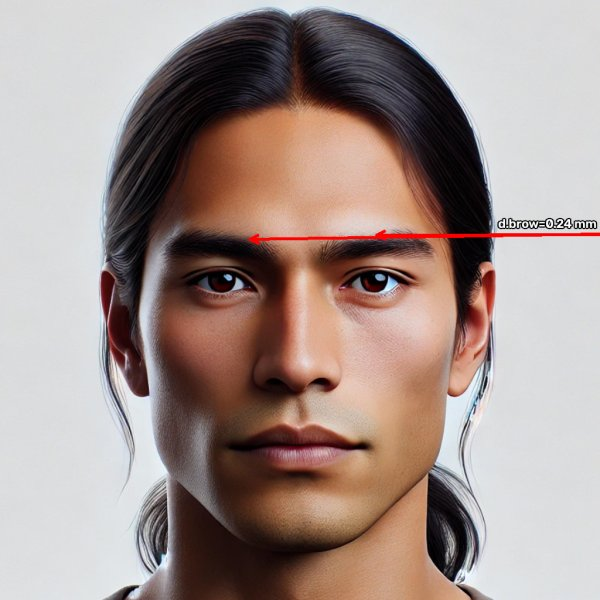
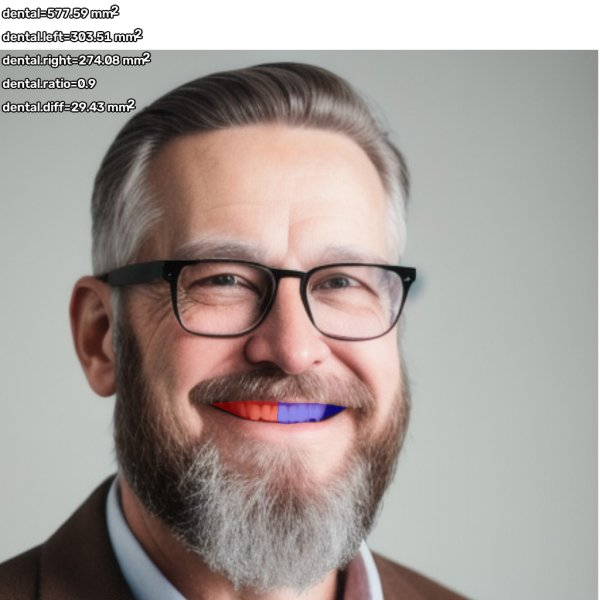
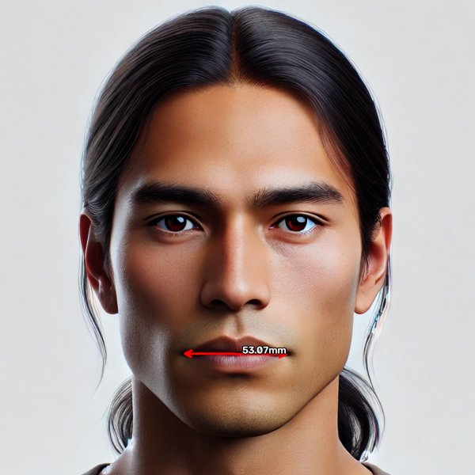
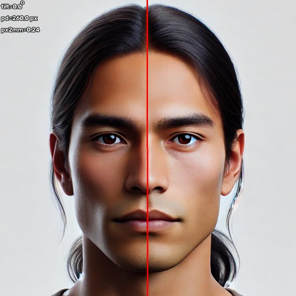
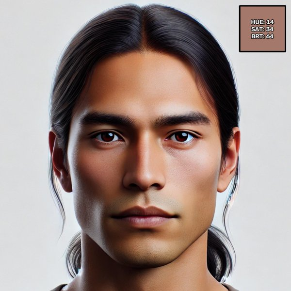
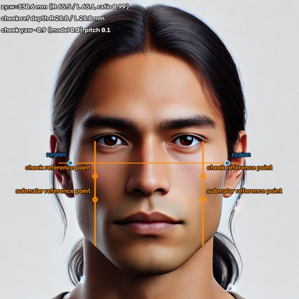
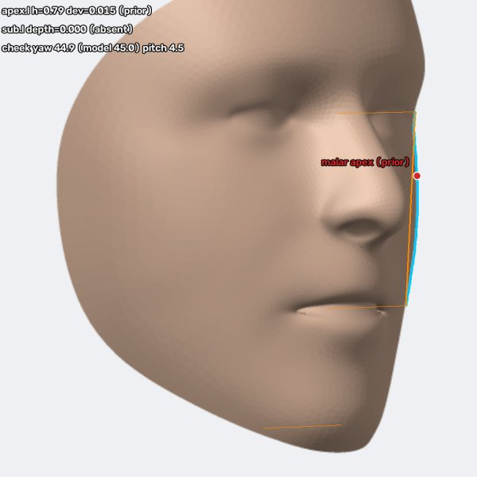
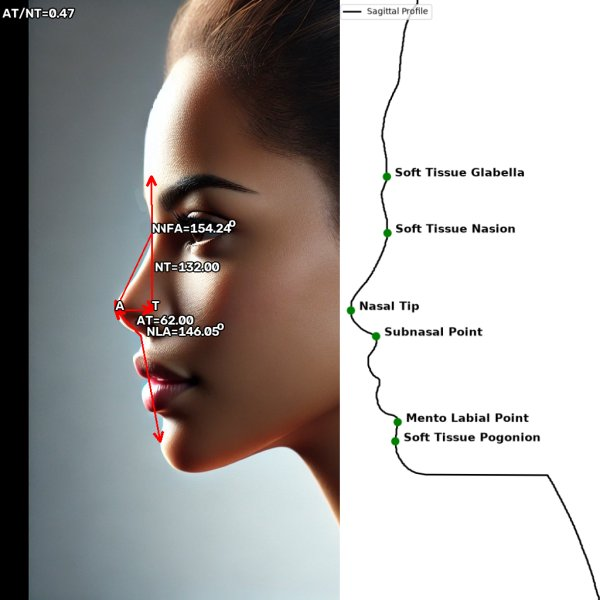

# Measures

Dynaface computes the measurements below from landmarks it places automatically: 98 points on a frontal or three-quarter face, in the [WFLW layout](guide/landmarks.md), ten [cheek points](guide/landmarks.md#cheek-landmarks) constructed or observed from them, and six points along the outline of a profile. The Python and .NET libraries and the desktop and mobile apps all use the same definitions (the mobile app doesn't show the cheek landmarks yet). Landmark numbers on this page refer to the [landmark figure](guide/landmarks.md).

Each measure is a plugin class. [`all_measures()`][dynaface.measures.all_measures] returns all of them, and [`analyze()`][dynaface.facial.AnalyzeFace.analyze] returns their outputs by name, such as `results["fai"]`. The apps use the same names for their CSV columns.

## How values are reported

- **A standard image.** Each photo, and each frame of a video, is scaled and cropped to a standard 1024 by 1024 image, with the pupils 260 pixels apart, before anything is measured.
- **Millimeters.** Distances (mm) and areas (mm²) are converted from pixels by assuming the pupils are 63 mm apart, the adult average. Set the subject's own [pupillary distance](guide/units.md#using-the-subjects-pupillary-distance) when absolute sizes matter. Ratios and angles don't depend on it.
- **Left and right are the subject's own sides.** In an ordinary, unmirrored photo, the subject's right side is on the left of the image. A mirrored selfie swaps them.
- **Symmetry ratios** divide the smaller side by the larger, so 1.0 means the two sides are equal and lower values mean more asymmetry.
- **Missing values.** A value that can't be determined, such as an angle whose profile point wasn't found, is NaN. If a measure can't run at all, its outputs are `None`.
- **Views.** The View column of the summary says which views a measure suits: frontal; quarter, a [three-quarter photo](guide/capture.md#three-quarter-photos) with the head turned about 45 degrees, which Dynaface detects only when asked to; and lateral, a profile. `analyze()` runs every measure you give it whatever the view, so [apply a selection](guide/results.md#frontal-photos-three-quarter-photos-and-profiles) to run only the ones that suit it.

## Summary

```python exec="on"
import inspect
import re

from dynaface.measures import all_measures

print("| Measure | View | Outputs | Description |")
print("|---|---|---|---|")
for measure in all_measures():
    cls = type(measure)
    views = [
        v
        for v, on in (
            ("frontal", measure.is_frontal),
            ("quarter", measure.is_quarter),
            ("lateral", measure.is_lateral),
        )
        if on
    ]
    outputs = measure.outputs()
    shown = (f"`{outputs[0]}` to `{outputs[-1]}` ({len(outputs)} values)" if len(outputs) > 6
             else ", ".join(f"`{name}`" for name in outputs))
    summary = " ".join((inspect.getdoc(cls) or "").split("\n\n")[0].split())
    summary = summary.replace("|", "\\|")
    # Each measure's section below has this anchor: AnalyzeSkinTone -> #skin-tone.
    anchor = re.sub(r"(?<=[a-z])(?=[A-Z])", "-", cls.__name__.removeprefix("Analyze")).lower()
    print(f"| [{measure.abbrev()}](#{anchor}) | {', '.join(views)} | {shown} | {summary} |")
```

## Frontal symmetry

### Facial Asymmetry Index (FAI) { #fai }

The distance from the inner corner of each eye (medial canthus) to the corner of the mouth (oral commissure) on the same side, compared between the two sides. FAI is the absolute difference between the left and right distances, in millimeters, so 0 means the two sides match. For the index's validation in smile restoration research, see [Malm et al., 2018](https://pubmed.ncbi.nlm.nih.gov/30041270/).

<figure markdown="span">
  { width="360" loading=lazy }
  <figcaption>The two distances FAI compares.</figcaption>
</figure>

**Calculation:** the right distance is from landmark 64 to 76 and the left from 68 to 82; `fai` is the absolute difference between them. FAI tells you how unequal the sides are, not which side is longer.

| Output | Description | Units |
|---|---|---|
| `fai` | Difference between the left and right canthus-to-commissure distances | mm |

API: [`AnalyzeFAI`][dynaface.measures_frontal.AnalyzeFAI]

### Oral Commissure Excursion (Oral CE) { #oral-commissure-excursion }

The distance from each corner of the mouth to the midpoint of the lower lip, in millimeters, reported separately for the left and right sides. Comparing values at rest and during a smile shows how far each corner moves.

<figure markdown="span">
  { width="360" loading=lazy }
  <figcaption>Each corner of the mouth to the middle of the lower lip.</figcaption>
</figure>

**Calculation:** `oce.r` is the distance from landmark 76 to 85, and `oce.l` from 82 to 85.

| Output | Description | Units |
|---|---|---|
| `oce.l` | Left corner of the mouth to the middle of the lower lip | mm |
| `oce.r` | Right corner of the mouth to the middle of the lower lip | mm |

API: [`AnalyzeOralCommissureExcursion`][dynaface.measures_frontal.AnalyzeOralCommissureExcursion]

### Brow height (Brow) { #brows }

The difference in height between the left and right eyebrows, in millimeters, measured at the middle of each brow.

<figure markdown="span">
  { width="360" loading=lazy }
  <figcaption>Lines through the middle of each brow, parallel to the line between the pupils.</figcaption>
</figure>

**Calculation:** a line is drawn through the middle of each brow's upper edge (landmarks 35 and 44), parallel to the line between the pupils, and `brow.d` is the vertical distance between the two lines. When the pupils are level, that's the difference in height between the two landmarks. Like FAI, it doesn't say which brow is higher.

| Output | Description | Units |
|---|---|---|
| `brow.d` | Difference in height between the brows | mm |

API: [`AnalyzeBrows`][dynaface.measures_frontal.AnalyzeBrows]

### Eye area { #eye-area }

The area of each eye opening (palpebral fissure), outlined by eight landmarks around the eyelid margins, in mm². Dynaface reports each side, the difference between them and their symmetry ratio.

<figure markdown="span">
  { width="360" loading=lazy }
  <figcaption>The two eye openings, filled.</figcaption>
</figure>

**Calculation:** the right eye is the polygon through landmarks 60 to 67, and the left eye through 68 to 75.

| Output | Description | Units |
|---|---|---|
| `eye.left` | Area of the left eye opening | mm² |
| `eye.right` | Area of the right eye opening | mm² |
| `eye.diff` | Difference between the two areas, rounded to 0.01 | mm² |
| `eye.ratio` | Symmetry ratio of the two areas | none |

API: [`AnalyzeEyeArea`][dynaface.measures_frontal.AnalyzeEyeArea]

### Dental display { #dental-area }

The area of the mouth opening inside the inner edges of the lips, where the teeth show during a smile, in mm². The opening is split at the facial midline, and Dynaface reports the total, each side, the difference between the sides and their symmetry ratio.

<figure markdown="span">
  { width="360" loading=lazy }
  <figcaption>The subject's right half of the opening in red, the left in blue.</figcaption>
</figure>

**Calculation:** the opening is the polygon through the inner-lip landmarks 88 to 95. The midline is perpendicular to the line between the pupils, through its middle; the subject's right half is the part on the image's left. With the mouth closed, every area is 0 and the ratio is 1.

| Output | Description | Units |
|---|---|---|
| `dental_area` | Total area of the opening | mm² |
| `dental_left` | Area of the left half | mm² |
| `dental_right` | Area of the right half | mm² |
| `dental_ratio` | Symmetry ratio of the two halves | none |
| `dental_diff` | Difference between the two halves | mm² |

API: [`AnalyzeDentalArea`][dynaface.measures_frontal.AnalyzeDentalArea]

## Frontal distances

### Intercanthal distance { #intercanthal-distance }

The distance between the inner corners of the eyes, in millimeters: landmarks 64 and 68.

<figure markdown="span">
  { width="360" loading=lazy }
</figure>

| Output | Description | Units |
|---|---|---|
| `id` | Distance between the inner corners of the eyes | mm |

API: [`AnalyzeIntercanthalDistance`][dynaface.measures_frontal.AnalyzeIntercanthalDistance]

### Outer eye corners { #outer-eye-corners }

The distance between the outer corners of the eyes (lateral canthi), in millimeters: landmarks 60 and 72.

<figure markdown="span">
  { width="360" loading=lazy }
</figure>

| Output | Description | Units |
|---|---|---|
| `oe` | Distance between the outer corners of the eyes | mm |

API: [`AnalyzeOuterEyeCorners`][dynaface.measures_frontal.AnalyzeOuterEyeCorners]

### Mouth length { #mouth-length }

The distance between the corners of the mouth, measured where the lips meet, in millimeters: the inner-lip landmarks 88 and 92.

<figure markdown="span">
  { width="360" loading=lazy }
</figure>

| Output | Description | Units |
|---|---|---|
| `ml` | Distance between the corners of the mouth | mm |

API: [`AnalyzeMouthLength`][dynaface.measures_frontal.AnalyzeMouthLength]

### Nose (frontal) { #nose-frontal }

Two widths of the nose seen from the front, in millimeters, measured between points on the nose's lower outline: the alar width, between the outer edges of the nostrils (landmarks 55 and 59), and the nostril width, between the middles of the two nostrils (56 and 58).

<figure markdown="span">
  { width="360" loading=lazy }
</figure>

| Output | Description | Units |
|---|---|---|
| `nose.alar` | Alar width | mm |
| `nose.nostril` | Nostril width | mm |

API: [`AnalyzeNoseFrontal`][dynaface.measures_frontal.AnalyzeNoseFrontal]

## Head position, pose and color

### Position { #position }

The head's tilt in the image (the angle of the line between the pupils), the distance between the pupils in pixels, and the resulting millimeters-per-pixel scale used for every millimeter measurement.

<figure markdown="span">
  { width="360" loading=lazy }
  <figcaption>The facial midline, perpendicular to the line between the pupils.</figcaption>
</figure>

**Calculation:** `tilt` is 0 when the pupils are level, and positive when the pupil on the image's right is lower. Dynaface doesn't straighten tilted faces unless you give [`load_face_image()`][dynaface.facial.load_face_image] a `tilt_threshold`, and then `tilt` is what remains after straightening. `px2mm` is the subject's pupillary distance (63 mm unless you [set it](guide/units.md#using-the-subjects-pupillary-distance)) divided by `pd`. For a profile, where both pupils can't be seen, `px2mm` is fixed at 0.24. For a three-quarter face it's NaN, and its line isn't drawn: the turn foreshortens the pupils, so no millimeter is defined on a turned head (see [Turned heads](guide/units.md#turned-heads)); `tilt` and `pd` are still reported.

| Output | Description | Units |
|---|---|---|
| `tilt` | Angle of the line between the pupils | degrees |
| `pd` | Distance between the pupils in the standard image | pixels |
| `px2mm` | Millimeters per pixel | mm |

API: [`AnalyzePosition`][dynaface.measures_frontal.AnalyzePosition]

### Pose { #pose }

Estimated head rotation in degrees: pitch (nodding up and down), yaw (turning left and right) and roll (tilting toward a shoulder). Useful for checking that a subject was facing the camera.

**Calculation:** the landmark model, [SPIGA](guide/how-it-works.md#2-place-the-landmarks), estimates the head pose along with the landmarks. Dynaface also uses the yaw to decide whether a photo shows a profile or, with `config.AUTO_QUARTER` on, a three-quarter face. SPIGA reads about 0.63 of a turn (28 degrees for a true 45 on synthetic renders of a head), so `yaw` understates a turned head; the [Cheek Measures](#cheek-measures)' Head turn item reports a calibrated yaw. Pose only writes its values on the image.

| Output | Description | Units |
|---|---|---|
| `pitch` | Nodding up or down | degrees |
| `roll` | Tilting toward a shoulder | degrees |
| `yaw` | Turning left or right | degrees |

API: [`AnalyzePose`][dynaface.measures_frontal.AnalyzePose]

### Skin tone { #skin-tone }

The average color of two patches on the cheeks, as hue (degrees), saturation and brightness (percent). Lighting, white balance and makeup all change it, so compare photos taken under the same conditions. The apps don't chart it for video.

<figure markdown="span">
  { width="360" loading=lazy }
  <figcaption>The average color, as a swatch in the corner.</figcaption>
</figure>

**Calculation:** Dynaface averages the color of two rectangles, one on each cheek between the outline of the face and the side of the nose (bounded by landmarks 2, 3 and 55 on the right, and 30 and 59 on the left), in the image before anything is drawn on it. The average is converted to hue, saturation and value (brightness), and each is rounded down to a whole number.

| Output | Description | Units |
|---|---|---|
| `hue` | Hue, from 0 to 360 | degrees |
| `sat` | Saturation | percent |
| `brightness` | Brightness (value) | percent |

API: [`AnalyzeSkinTone`][dynaface.measures_skin.AnalyzeSkinTone]

### Landmarks { #landmarks }

The position of every landmark, so you can calculate your own measures: the 98 landmarks and the ten [cheek landmarks](guide/landmarks.md#cheek-landmarks). It also draws them as dots.

The 98 landmarks' outputs are numbered from 1, for spreadsheets: `landmark-1-x` is the x of landmark 0 in the [landmark figure](guide/landmarks.md), and `landmark-98-y` the y of landmark 97, one item each. The cheek landmarks' 20 coordinates come last, under one item, "Cheek Landmarks", a group that stands for all of them: switching it off drops the 20 from [`get_all_items()`][dynaface.facial.AnalyzeFace.get_all_items] and the CSV, and stops their drawing, without removing them from the results. They are `face.cheek_landmarks`, with the codes of `cheek.CHEEK_LANDMARK_OUTPUTS`, in the order of `cheek.CHEEK_LANDMARK_NAMES`: on a frontal face the zygion and the two reference points of each side, which the [Cheek Measures](#cheek-measures) construct, and on a three-quarter face the far cheek's malar apex and submalar point, which they observe; a point that doesn't exist in the view is NaN. Coordinates are in pixels of the standard image, with the origin at the top left.

Drawing: every landmark as a black dot under a white one and, while the Cheek Landmarks item is on, every cheek landmark found in the view the same way in orange, without labels, except a three-quarter face's submalar point where the outline shows no hollow (`sub.*.present` 0): its coordinates are still reported, but it isn't drawn, as the Cheek Measures' Submalar point item leaves it undrawn.

| Output | Description | Units |
|---|---|---|
| `landmark-1-x` to `landmark-98-y` | The x and y of each of the 98 landmarks | pixels |
| **Cheek Landmarks** | | |
| `zy.r.x`, `zy.r.y`, `zy.l.x`, `zy.l.y` | The constructed zygion of each side; NaN on a three-quarter face | pixels |
| `cr.r.x`, `cr.r.y`, `cr.l.x`, `cr.l.y` | The cheek reference point of each side; NaN on a three-quarter face | pixels |
| `sr.r.x`, `sr.r.y`, `sr.l.x`, `sr.l.y` | The submalar reference point of each side; NaN on a three-quarter face | pixels |
| `apex.r.x`, `apex.r.y`, `apex.l.x`, `apex.l.y` | The observed malar apex on the far cheek's outline; NaN on a frontal face and for the near side | pixels |
| `sub.r.x`, `sub.r.y`, `sub.l.x`, `sub.l.y` | The observed submalar point, the deepest row between the apex and the stomion level against the chord joining them (with `sub.*.present` 0, the row that comes nearest the chord, not a hollow); NaN when its depth is, on a frontal face and for the near side | pixels |

API: [`AnalyzeLandmarks`][dynaface.measures_frontal.AnalyzeLandmarks]

## Cheeks (frontal and three-quarter)

### Cheek measures { #cheek-measures }

Three points on each cheek that no landmark model places: the zygion, the widest point of the face over the cheekbone; the malar apex, the most prominent point of the cheek; and the submalar point, the hollow below it. Dynaface constructs or observes them, and which it does depends on the view. On a frontal photo it constructs the zygion of each side from the 98 landmarks, along with two reference points per side, a cheek reference point and a submalar reference point, which anchor the cheek region but are not the apex and the hollow. On a three-quarter photo, with the head turned about 45 degrees, it observes the malar apex and the submalar point on the outline of the far cheek, the one away from the camera, so one photo measures one cheek and a visit needs two photos with mirrored turns. Their coordinates, the [ten cheek landmarks](guide/landmarks.md#cheek-landmarks), are the [Landmarks](#landmarks) measure's Cheek Landmarks item; this measure, Cheek Measures, reports the numbers about them in six items, two for a frontal photo, three for a three-quarter photo and the head turn for both, and an item's numbers are NaN in the view it doesn't suit. The apex follows [Kaptein, Kaptein and Markarian (2015)](https://pmc.ncbi.nlm.nih.gov/articles/PMC4494481/), whose readers found its height remarkably constant on the far side of a turned face, and the submalar point is the midfacial concave point of Zhu et al. (2024). Dynaface only treats a photo as three-quarter when you ask it to: see [Three-quarter photos](guide/capture.md#three-quarter-photos).

<figure markdown="span">
  { width="360" loading=lazy }
  <figcaption>Frontal: the zygion level line with a zygion at each end (Zygion width), and a vertical from each outer eye corner with the cheek reference point and the submalar reference point on it (Reference points), under the text lines of those two items and of Head turn.</figcaption>
</figure>

**Calculation, frontal:** every construction is made in a frame on the pupil axis, the line between landmarks 96 and 97, so a tilted head doesn't move the points. The zygion of each side is where a line parallel to the pupil axis, 0.3 pupillary distances below it (about 19 mm at 63 mm, roughly the level of the lower rim of the eye socket), crosses the outline of the face, interpolated along landmarks 0 to 4 on the subject's right and 32 to 28 on the left. That level is a convention: a line at the eyelids or the eye corners meets the outline at its very top, landmark 0 or 32, the noisiest outline point. `zy.r` and `zy.l` are the zygions' distances from the midline, the perpendicular to the pupil axis through the point midway between the pupils; `zy.w`, their sum, is the bizygomatic width, and `zy.ratio` their symmetry ratio. When the level misses the outline, the zygion is clipped to the nearer end, and `zy.r.clip` or `zy.l.clip` is 1 (above landmark 0 or 32) or 2 (below 4 or 28). The cheek reference point is Wilkinson's construction: a vertical, perpendicular to the pupil axis, runs from the outer eye corner (60 or 72) down to where it crosses the outline of the face (its lowest crossing, interpolated), and the point is one third of the way down it, with no sideways offset; `cr.r.d` and `cr.l.d` are its depth below the eye corner. The submalar reference point is halfway from the cheek reference point down to the stomion level, the mean height of the inner-lip midpoints (90 and 94), on the same vertical. Both reference points are built from the eyes, the mouth and the outline, so they anchor a cheek region but can't register a change in the cheek itself, which is why neither is called an apex.

<figure markdown="span">
  { width="360" loading=lazy }
  <figcaption>Three-quarter: the far cheek's outline, the eye-corner, stomion and chin levels and the chord between the outline at the first two (Far cheek outline), and the malar apex found on it (Malar apex), a prior here; the submalar point is drawn only when a hollow is present, and this head has none (Submalar point). The text lines are those of Malar apex, Submalar point and Head turn.</figcaption>
</figure>

**Calculation, three-quarter:** [U²-Net](guide/models.md) removes the background, as for a profile, and Dynaface traces the far cheek's edge row by row, from the outer eye corner (or the top of the outline landmarks, whichever is higher) down to the chin, starting each row at the far half of the outline landmarks (0 to 16 or 32 to 16) and walking to the mask's edge, which it places to a fraction of a pixel. A row where the mask has no edge within reach, such as hair against the cheek, keeps the landmark outline or, when the tracer is given the gray image, takes the strongest intensity edge beside it within the same reach, which shapes the outline but never counts as a mask row; the rows where the nose joins the outline are marked and keep the landmark outline too: a row from the mask between the levels of the nose tip (54) and the base of the nose (57) whose edge departs outward from the landmark outline by more than 0.01 of the chin-to-eye-corner distance beyond the typical departure of the mask rows between the stomion and eye-corner levels (their median outside that band: the mask's edge and the landmarks each sit a pixel or two off the silhouette along the whole outline), extended upward from the tip's level while rows keep departing so, and `cheek.nose` is 1 when there is any such row or the nose tip lies outside the traced outline at its row (`cheek.nose.gap` at or below 0); `cheek.mask` is the fraction of the rows between the eye-corner and stomion levels that came from the mask. Heights follow Kaptein: the lines through the two outer eye corners and through the two alar bases (55 and 59) meet at a vanishing point, and the levels through the far eye corner, the stomion and the chin (16) are drawn from it, so perspective cancels. A point's height ratio h is its distance above the chin level over the eye-corner level's distance above the chin level, both read along the vertical through the point; H, that chin-to-eye-corner distance on the far eye corner's vertical, is `cheek.scale`, and every oblique height and depth is a fraction of it. The malar apex is the outline's most prominent point: its outward deviation from the chord joining the outline at the eye-corner level and at the stomion level is smoothed over 9 rows, and among the local maxima of at least 0.01 H with h between 0.71 and 0.83, Kaptein's observed range, the one with h nearest 0.793, his mean, is the apex. A local maximum is read only on rows that came from the mask, with mask rows throughout the 9-row window and one row beyond it: the landmark outline sits a pixel or two inside the mask's edge, so a run of rows where it (or the intensity edge) stood in is a step whose smoothed shoulders would read as a bulge or a hollow. When no local maximum qualifies, the apex is the prior: of the rows in the search window that came from the mask (never a row the nose joins), the one nearest h = 0.793, so its position and the chord the submalar point is read against rest on a traced edge; only when no row of the window came from the mask (hair over all of it, so `apex.ok` is 0) is it the outline point at h = 0.793 whatever stood in there, and then no depth is read. `apex.*.prior` is 1 either way. The submalar point is the deepest point below the apex, down to the stomion level, measured inward from the chord between the apex and the outline at the stomion level, over the rows between those two ends and read on mask rows the same way: `sub.*.depth` is that depth, positive inward, so a convex cheek reads about zero or slightly negative, and `sub.*.present` is 1 when it reaches 0.003 H; below that the point is still reported, wherever the outline comes nearest the chord (on a convex cheek a row beside one of the chord's ends), but it isn't a landmark, and neither the Submalar point item nor the Landmarks measure's Cheek Landmarks item draws it: the chord shows the span searched. Only the far cheek is measured: `cheek.far` says which (0 for the subject's right, 1 for the left), and the near side's outputs are NaN. The photo taken from the subject's right shows the left cheek's outline, so a right-cheek apex comes from the photo taken from the subject's left.

**Gates and flags:** every value is reported whatever the pose, with a flag that says whether the pose allowed it, so a chart shows where the head turned instead of a gap. The yaw the flags use is `cheek.yaw`, measured from the landmarks: the nose tip's offset from the midpoint of the outer eye corners, corrected for roll and calibrated on synthetic renders of known turn. SPIGA's own yaw reads about 0.63 of a turn, and about a degree over on every reading (it reads the level synthetic head as turned 1.5 degrees, and the mirrored turns 2.5 degrees apart), so `cheek.yaw.model` is that yaw less the constant and calibrated the same way, and every yaw gate also needs the two within 5 degrees of each other. On a frontal face, `zy.r.ok` and `zy.l.ok` are 1 when that zygion isn't clipped and `cheek.yaw` is within 5 degrees of 0, per point, so one clipped zygion doesn't invalidate the other; `zy.ok`, the gate of the width, needs both; `zy.ratio.ok` needs `zy.ok` and a yaw within 2 degrees, because the side ratio moves about 3% per degree of turn; `cr.ok` and `sr.ok` are the yaw gate alone, per pair, since the pose is their only condition and the verticals always cross the outline. On a three-quarter face, `apex.ok` is 1 when `cheek.yaw` is within 5 degrees of 45 either way, the nose doesn't join the outline (`cheek.nose` is 0), the apex's height isn't within 0.02 of the nose tip's (`apex.*.near_nose` is 0) and at least 80% of the rows in the search window came from the mask; `sub.ok` is 1 when `apex.ok` is and the depth isn't NaN. The depth is NaN when fewer than 80% of the rows from the apex down came from the mask, because the landmark outline never shows a hollow. Pitch is uncalibrated, so it enters only `cheek.pitch.ok`, 1 when `cheek.pitch` is within 20 degrees of 0, and no other flag; combine it with the others yourself.

**Items and drawing:** the measure has six items, in this order, and each is a switch named for one thing it draws that stands for the numbers about it: switching an item off stops its drawing and its line in the text column, and drops its outputs from [`get_all_items()`][dynaface.facial.AnalyzeFace.get_all_items] and the CSV, but every value is still in the results and none depends on which items are on. Each item also suits only the views where it means something, so [`update_for_type()`][dynaface.measures_base.MeasureBase.update_for_type] and a [`MeasureSelection`](guide/results.md#frontal-photos-three-quarter-photos-and-profiles) switch the frontal items off on a three-quarter face and the three-quarter items off on a frontal one, and in a video an item's outputs are NaN on every frame whose view it doesn't suit. The text column holds at most three lines of values for any one face, followed on a three-quarter face whose result is flagged by one line per reason, described after the list.

1. **Zygion width** (frontal): the orange zygion level line, a blue zygion dot with a white rim at each end (gray when that side's `zy.*.ok` is 0) labeled "zygion" above it, with " (clipped)" when it was clipped, and the text line `zy.w=130.6 mm (R 65.5 / L 65.1, ratio 0.99)`, with " (flagged)" when `zy.ok` is 0.
2. **Reference points** (frontal): an orange vertical from each outer eye corner down to the outline of the face, the cheek reference point and the submalar reference point on it as open orange rings (gray when `cr.ok` is 0) labeled "cheek ref" and "submalar ref" beside them, and the text line `cheek ref depth R 28.8 / L 28.8 mm`.
3. **Far cheek outline** (three-quarter): the far cheek's outline from the eye-corner level to the stomion level, cyan where the rows came from the mask, gray where the landmarks stood in, magenta on the rows the nose joins and yellow where an intensity edge stood in; the eye-corner, stomion and chin levels as thin orange ticks running inward from the outline; and the chord between the outline at the first two, which also shows the span the submalar point was looked for in.
4. **Malar apex** (three-quarter): a red dot with a white rim (gray when `apex.ok` is 0) labeled "malar apex", with " (prior)" or " (nose?)", and the text line `apex.l h=0.79 dev=0.012 (prior)`.
5. **Submalar point** (three-quarter): a green dot labeled "submalar point" when a hollow is present (`sub.*.present` 1), nothing otherwise, and the text line `sub.l depth=0.006 (hollow)` or `(absent)`, with " (flagged)" when `sub.ok` is 0, none when the depth is NaN.
6. **Head turn** (frontal and three-quarter): the text line `cheek yaw 44.6 (model 42.3) pitch 4.7`, with " (flagged)" when the view's gate (`zy.ok` on a frontal face, `apex.ok` on a three-quarter face) or `cheek.pitch.ok` is 0.

When a three-quarter result is flagged, the text column says why, one line per reason, each starting with "flagged: ", after the lines above. Under **Malar apex** or **Head turn**, whose lines carry the apex's flag, each check `apex.ok` failed, in this order: `turned too far (50.1 degrees, needs 40 to 50)` or `not turned enough (...)` (a value that would round onto the limit reads "just over 50"), `the turn estimates differ (50.1 and 43.2 degrees)` (`cheek.yaw` and `cheek.yaw.model` more than 5 degrees apart), `the nose hides the far cheek` (`cheek.nose` 1), `the apex is level with the nose tip` (`apex.*.near_nose` 1) and `the cheek's edge is unclear (hair or background)` (too few of the search window's rows came from the background model; not written when the nose is on the outline, since its rows are the reason). Under **Submalar point**, when the depth is NaN, `no submalar depth (the edge is unclear below the apex)`, or `(the nose covers the cheek below the apex)` when nose rows are why. Under **Head turn**, `head tipped up or down (pitch 25.0, needs within 20)` when `cheek.pitch.ok` is 0. And `the far cheek could not be measured` when there are no observed points at all. A frontal face writes no reason lines.

Each label sits on its point's outer side, away from the face, and never crosses the face to the other side. It is beside the point, centered on its row, except a zygion's, which sits above the dot because the level line runs along that row. A label with no room before the image's edge is held at the edge and raised above its point, and a label that would touch another label or a dot moves up or down a line to the nearest free row.

**Export:** [`all_measures()`][dynaface.measures.all_measures] ends with this measure, enabled like the others, so a plain `analyze()` with the default measures draws its two frontal items on every frontal photo and its three three-quarter items on every three-quarter photo, with the head turn's line on both, and [`get_all_items()`][dynaface.facial.AnalyzeFace.get_all_items], [`FrameSeries`](guide/video.md) and the CSV gain its 41 columns, in the order of the table below, about half of them NaN in any one view. A [`MeasureSelection`](guide/results.md#frontal-photos-three-quarter-photos-and-profiles) can leave the measure or any of its items out. The Dynaface apps choose their own measures. The desktop app keys its measure list on the view: on a three-quarter face (its "Three-quarter (3/4)" pose choice, or detection once its "Detect three-quarter view" preference is on) it switches the millimeter measures off and offers this one, keeping the user's choices for the next frontal frame, and it grays the items that don't suit the view shown. The Unity app (mobile, Windows and macOS) does the same from 2.1: its pose rows add Force Three-quarter, its Settings add Detect Three-Quarter View, and its measurements panel dims the items that don't suit the view.

| Output | Description | Units |
|---|---|---|
| **Zygion width** | | |
| `zy.r`, `zy.l` | Each zygion's distance from the midline | mm |
| `zy.w` | Bizygomatic width, `zy.r` plus `zy.l` | mm |
| `zy.ratio` | Symmetry ratio of `zy.r` and `zy.l` | none |
| `zy.ratio.ok` | 1 when `zy.ok` is 1 and the yaw is within 2 degrees of 0 | flag |
| `zy.r.clip`, `zy.l.clip` | 0 when the level crossed the outline, 1 when it passed above landmark 0 or 32, 2 when it passed below 4 or 28 | code |
| `zy.r.ok`, `zy.l.ok` | 1 when that zygion isn't clipped and the yaw gate passes | flag |
| `zy.ok` | 1 when both zygions are ok: the gate of the width and the ratio | flag |
| **Reference points** | | |
| `cr.r.d`, `cr.l.d` | The cheek reference point's depth below the outer eye corner | mm |
| `cr.ok` | 1 when the yaw gate passes | flag |
| `sr.ok` | 1 when the yaw gate passes, for the submalar reference points | flag |
| **Far cheek outline** | | |
| `cheek.far` | The cheek measured: 0 for the subject's right, 1 for the left; reported on every three-quarter face, even one whose other oblique outputs are NaN | flag |
| `cheek.mask` | Fraction of the outline rows between the eye-corner and stomion levels that came from the mask | none |
| `cheek.nose` | 1 when the nose joins the far cheek's outline | flag |
| `cheek.nose.gap` | The gap from the nose tip to the outline at the tip's row, positive inside the face | fraction of H |
| `cheek.scale` | H, the chin-to-eye-corner distance on the far eye corner's vertical | pixels |
| **Malar apex** | | |
| `apex.r.h`, `apex.l.h` | Its height ratio: chin level to the point over chin level to eye-corner level | fraction of H |
| `apex.r.dev`, `apex.l.dev` | Its outward deviation from the chord between the outline at the eye-corner and stomion levels | fraction of H |
| `apex.r.prior`, `apex.l.prior` | 1 when no local maximum qualified and the outline point at h = 0.793 was used | flag |
| `apex.r.near_nose`, `apex.l.near_nose` | 1 when the apex's height is within 0.02 of the nose tip's | flag |
| `apex.ok` | 1 when the yaw is within 5 degrees of 45, the nose is off the outline, the apex isn't near the nose and the search window is mostly mask | flag |
| **Submalar point** | | |
| `sub.r.h`, `sub.l.h` | Its height ratio | fraction of H |
| `sub.r.depth`, `sub.l.depth` | Its depth inward from the apex-to-stomion chord, positive inward, so a convex cheek reads about zero or slightly negative; NaN when the rows below the apex are mostly not from the mask | fraction of H |
| `sub.r.depth.px`, `sub.l.depth.px` | The same depth | pixels |
| `sub.r.present`, `sub.l.present` | 1 when the depth reaches 0.003 H, 0 below it, NaN when the depth is | flag |
| `sub.ok` | 1 when `apex.ok` is 1 and the depth isn't NaN | flag |
| **Head turn** | | |
| `cheek.yaw` | The turn measured from the landmarks, positive when the nose points to the image's right | degrees |
| `cheek.yaw.model` | SPIGA's yaw, calibrated | degrees |
| `cheek.pitch` | SPIGA's pitch, uncalibrated | degrees |
| `cheek.pitch.ok` | 1 when `cheek.pitch` is within 20 degrees of 0 | flag |

The points themselves, `zy.r.x` to `sub.l.y`, are the [Landmarks](#landmarks) measure's Cheek Landmarks item.

**Caveats:** the zygion is among the least reproducible facial landmarks however it's found, on photographs, on 3D scans or by hand, and the skin over the cheekbone barely moves in facial palsy, so treat it as a static reference, such as a face width to normalize by, not a movement measure. SPIGA's outline landmarks read a half-width ratio of about 1.1 on a symmetric synthetic head facing the camera, and no gate removes that bias from `zy.ratio`, so compare a person's ratio over time rather than against 1. The reference points can't see the cheek itself. On a three-quarter photo the apex and submalar point are silhouette features: where the far cheek's outline is depends on the turn, by about a millimeter per degree, which is why the yaw is measured, gated and reported with every point and why a visit's two photos should be turned alike (see [Three-quarter photos](guide/capture.md#three-quarter-photos)). One photo measures one cheek. The yaw calibration was fitted on one synthetic head, and the apex rule rests on Kaptein's patients at rest; nothing here is validated on a smile, so measure rest expressions. On that head facing the camera the landmark yaw reads about 2 degrees (SPIGA puts its nose tip 0.02 eye-corner spans off center, a reading the mirrored turns don't share, so the calibration's zero wasn't moved to it), which fails the 2 degree gate of `zy.ratio.ok` on a level head by a tenth of a degree while `zy.ok` passes: read `zy.ratio.ok` with `cheek.yaw` beside it.

The submalar threshold, 0.003 H, was set on synthetic renders, where no plain face reached it, a 3 mm bump without a hollow read just over it on the true silhouette (that render hasn't been read through the shipped tracer, which reads a pressed hollow at 0.6 to 0.8 of its silhouette depth), a 3 mm hollow read about one and a half times it, a 4.5 mm hollow about three times it and a 1.5 mm hollow nothing at all, and then checked on 408 photos of the Face Research Lab London set, both turns of 102 people at rest and smiling: reading a photo again resized by 3% or shifted 4 px moves the depth by under 0.001 H on nine faces in ten, on faces without a hollow the spread over those readings is 0.0008 H at the 90th percentile, and a convex cheek never reads below -0.0011 H, so the threshold is about three times the method's typical spread but not above its worst case. About three faces in ten read a hollow at rest (two in ten with `apex.ok` 1) against one in twenty smiling, and the hollow is called about three times as often when the apex is an observed bulge as when it is the prior, so read the depth at rest, at matched turns (it deepens with the turn inside the gate) and with `apex.*.prior` beside it. It's about 2 px in the standard image, so `sub.*.depth.px` shows the margin; a shallow hollow is a false negative, and a prominent cheek without a hollow can still read as present. On those photos the submalar point sat at h 0.49-0.63, just under the nose base, where the far outline turns from the cheek into the upper lip: the depth is the concavity between the malar bulge and the lip, Zhu's midfacial concave point, and whether that is the hollow a clinician means is an open question.

The apex on real faces: on the same 408 photos no local maximum qualified inside the 0.71-0.83 window on 35-47% of faces at rest and 68-78% smiling, so the apex was the prior; the 175 observed apexes sat at h 0.738 (interquartile range 0.725-0.764, sd 0.026) at every turn, 0.055 below the prior, 65 of them within 0.02 of the window's lower edge and 33 within 0.023 of 0.793. On 13 re-read prior faces the outline's largest chord deviation lay below the window, at h 0.54-0.70, between the subnasale and the nose tip, and two visual passes disagreed on whether Kaptein's height or that bulge is the malar prominence, so the extremum rule still awaits its reader check. Where a visit's two photos mix a prior and an observed apex (65 of 204 mirrored pairs) the prior side reads about 0.06 H (6 mm) higher, so compare apex heights only between two observed or two prior apexes; a 3% rescale or a 4 px shift switched prior and observed on 18 of 80 photos, a jump of 0.03-0.08 H. `apex.*.dev` is the chord deviation at the apex, not a bulge amplitude: a prior had a deviation of 0.01 H or more on 180 of 233 faces.

The two yaws disagree on real faces: on those 408 photos, whose turns weren't measured, the landmark yaw read a mean 2.3 degrees more turn than the calibrated model yaw (sd 3.6; the model's sd is about two thirds of the landmark's, 3.4 against 5.3), so the 5 degree agreement failed on one photo in four (19-20% of the photos turned to the subject's left, 27-35% of those turned right), the 40-50 degree gate passed two thirds of unmeasured "three-quarter" turns and `apex.ok` passed 39-48%; which estimate is right needs photos of measured turn. SPIGA's pitch read +4 to +6 on average there (-8 to 19, all under 20) and a subject's two turns agreed to a sd of 2 degrees: an offset per subject or rig, not noise.

The nose rule fired on 22 of the 408: 17 at 48-56 degrees with `cheek.nose.gap` from -0.075 to 0.033 H, where the silhouette is the nose, and 5 at 37-43 degrees with a gap of 0.08-0.19 H, where the mask's edge in the nose band is the cheek's own bulge departing from the landmark outline; it also missed two nose-wrapped outlines at a gap of 0.021-0.022 H, which `apex.*.near_nose` caught. Read `cheek.nose.gap` beside `cheek.nose`; no gap threshold is set. At 40-50 degrees the nose tip's height ratio runs 0.64-0.79 (0.69 on the 50 degree render), inside the lower half of the search window, so `apex.*.near_nose` is 1 on 12-20% of photos and on a quarter to a third of observed apexes, and alone held `apex.ok` at 0 on 31 of 408 (it would pass 50% instead of 42% without it); on the viewed cases the flagged outline was the nose's profile the nose rule hadn't marked, with a 0.026-0.028 H false hollow under it, so the veto stands.

Hair against the far cheek weakens the background mask and makes it unstable (on the one studio subject with strands over the cheek, `cheek.mask` read 0.90 as taken and 0.18 to 0.92 under a 3% rescale or a 4 px shift): rows the mask gives no edge on fall back to the landmark outline, or to the strongest intensity edge beside it, and either way count against `cheek.mask`. On 408 studio photos that intensity edge ran about 2 px inside the mask's edge on bare skin (within 3 px on 87% of rows) but on hair it followed the hair's outer edge, 5 to 22 px off, and would have read hollows of 0.006 to 0.047 H, which is why those rows never count and no bulge or hollow is read on them or within five rows of them; the prior apex takes a traced row of the window whenever there is one, so an apex sits on a stand-in row only when the whole window is one, with `apex.ok` 0 and no depth. The model also occasionally drops the far cheek on a plain background (about 2% of studio photos) or traces its edge well inside the skin: the first draws the outline yellow and reads no depth, the second draws jagged cyan rows the gates still count as traced, so look at the drawn image before trusting a value.

For a profile, this measure returns no outputs. The .NET library's `MeasureCheekMeasures` (labeled "CHEEK MEASURES", as its labels are all capitals) returns the same 41 outputs by the same names.

API: [`AnalyzeCheekMeasures`][dynaface.measures_cheek.AnalyzeCheekMeasures]; the constructions and the outline search are in [`dynaface.cheek` and `dynaface.cheek_outline`](python/api/cheek.md).

## Profile (lateral) { #lateral }

When a photo shows the face from the side, Dynaface removes the background, traces the outline of the face from forehead to chin, and marks [six points](guide/landmarks.md#profile-landmarks) along it: soft tissue glabella, soft tissue nasion, nasal tip, subnasal point, mentolabial point and soft tissue pogonion. These measurements are taken relative to the image's horizontal and vertical axes, so keep the head level in profile photos. They all come from one measure class.

<figure markdown="span">
  { width="480" loading=lazy }
  <figcaption>The angles and tip projection, and on the right, the traced outline with the six points found on it.</figcaption>
</figure>

**Nasofrontal angle (NFA).** The angle at the soft tissue nasion between the soft tissue glabella and the nasal tip, in degrees. It describes how deep the nasion is: larger angles mean a smoother, flatter nasal root, and smaller angles a deeper nasion. It's typically between 115° and 135°.

**Nasolabial angle (NLA).** The angle at the subnasal point between the nasal tip and the soft tissue pogonion, in degrees. It describes the angle of the base of the nose relative to the lower face. The classic nasolabial angle uses lines along the columella and the upper lip instead, so the two aren't directly comparable.

**Nasal tip projection (AT/NT).** AT is the horizontal distance from the nasal tip back to a vertical line through the soft tissue nasion, and NT is the vertical distance from the nasion down to the level of the tip. Their ratio, AT/NT, describes how far the tip projects relative to the length of the nose: higher ratios mean a more prominent tip. AT and NT are in pixels of the standard image, and the ratio has no units.

| Output | Description | Units |
|---|---|---|
| `nfa` | Nasofrontal angle | degrees |
| `nla` | Nasolabial angle | degrees |
| `at` | Horizontal distance from the nasal tip to the nasion's vertical | pixels |
| `nt` | Vertical distance from the nasion to the level of the tip | pixels |
| `at_nt` | Ratio AT/NT | none |

The measure's `tip_proj` item switches the drawing of AT and NT on and off; it has no value of its own. For a frontal photo, this measure returns no outputs.

API: [`AnalyzeLateral`][dynaface.measures_lateral.AnalyzeLateral]
