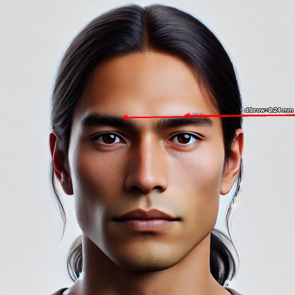
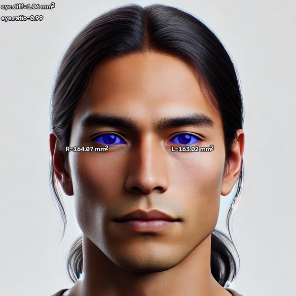
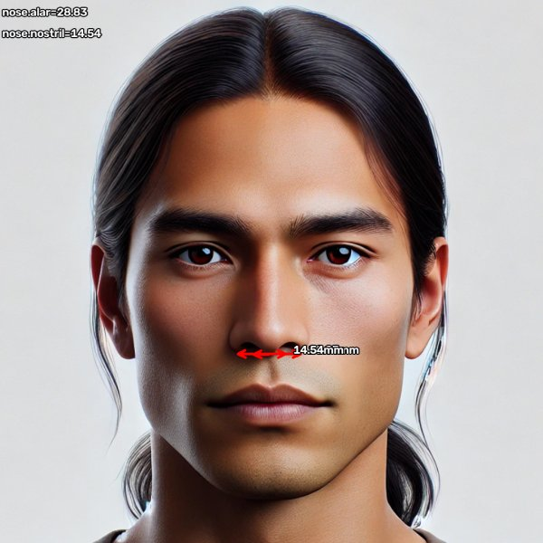
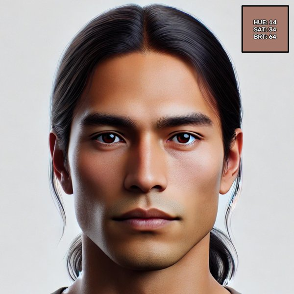
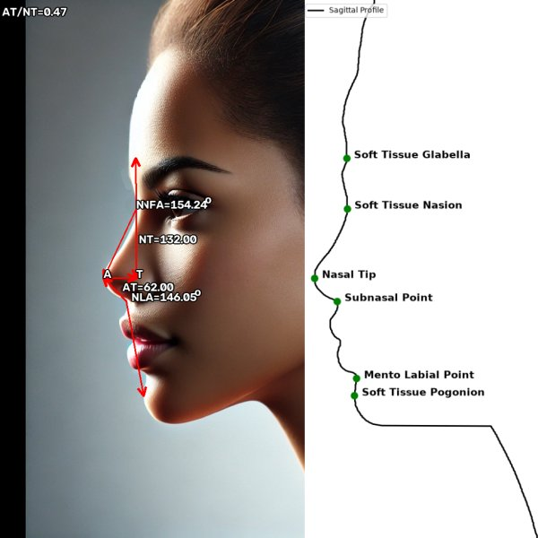

# Measures

Dynaface computes the measurements below from landmarks it places automatically: 98 points on a frontal face, in the [WFLW layout](guide/landmarks.md), and six points along the outline of a profile. The Python and .NET libraries and the desktop and mobile apps all use the same definitions. Landmark numbers on this page refer to the [landmark figure](guide/landmarks.md).

Each measure is a plugin class. [`all_measures()`][dynaface.measures.all_measures] returns all of them, and [`analyze()`][dynaface.facial.AnalyzeFace.analyze] returns their outputs by name, such as `results["fai"]`. The apps use the same names for their CSV columns.

## How values are reported

- **A standard image.** Each photo, and each frame of a video, is scaled and cropped to a standard 1024 by 1024 image, with the pupils 260 pixels apart, before anything is measured.
- **Millimeters.** Distances (mm) and areas (mm²) are converted from pixels by assuming the pupils are 63 mm apart, the adult average. Set the subject's own [pupillary distance](guide/units.md#using-the-subjects-pupillary-distance) when absolute sizes matter. Ratios and angles don't depend on it.
- **Left and right are the subject's own sides.** In an ordinary, unmirrored photo, the subject's right side is on the left of the image. A mirrored selfie swaps them.
- **Symmetry ratios** divide the smaller side by the larger, so 1.0 means the two sides are equal and lower values mean more asymmetry.
- **Missing values.** A value that can't be determined, such as an angle whose profile point wasn't found, is NaN. If a measure can't run at all, its outputs are `None`.

## Summary

```python exec="on"
import inspect
import re

from dynaface import facial  # noqa: F401 (must be imported before dynaface.measures)
from dynaface.measures import all_measures

print("| Measure | View | Outputs | Description |")
print("|---|---|---|---|")
for measure in all_measures():
    cls = type(measure)
    views = [v for v, on in (("frontal", measure.is_frontal), ("lateral", measure.is_lateral)) if on]
    outputs = [item.name for item in measure.items if not item.display_only]
    shown = (f"`{outputs[0]}` to `{outputs[-1]}` ({len(outputs)} values)" if len(outputs) > 6
             else ", ".join(f"`{name}`" for name in outputs))
    summary = " ".join((inspect.getdoc(cls) or "").split("\n\n")[0].split())
    summary = summary.replace("|", "\\|")
    # Each measure's section below has this anchor: AnalyzeSkinTone -> #skin-tone.
    anchor = re.sub(r"(?<=[a-z])(?=[A-Z])", "-", cls.__name__.removeprefix("Analyze")).lower()
    print(f"| [{measure.abbrev()}](#{anchor}) | {', '.join(views)} | {shown} | {summary} |")
```

## Frontal symmetry

### Facial Asymmetry Index (FAI) { #fai }

The distance from the inner corner of each eye (medial canthus) to the corner of the mouth (oral commissure) on the same side, compared between the two sides. FAI is the absolute difference between the left and right distances, in millimeters, so 0 means the two sides match. For the index's validation in smile restoration research, see [Malm et al., 2018](https://pubmed.ncbi.nlm.nih.gov/30041270/).

<figure markdown="span">
  { width="360" loading=lazy }
  <figcaption>The two distances FAI compares.</figcaption>
</figure>

**Calculation:** the right distance is from landmark 64 to 76 and the left from 68 to 82; `fai` is the absolute difference between them. FAI tells you how unequal the sides are, not which side is longer.

| Output | Description | Units |
|---|---|---|
| `fai` | Difference between the left and right canthus-to-commissure distances | mm |

API: [`AnalyzeFAI`][dynaface.measures_frontal.AnalyzeFAI]

### Oral Commissure Excursion (Oral CE) { #oral-commissure-excursion }

The distance from each corner of the mouth to the midpoint of the lower lip, in millimeters, reported separately for the left and right sides. Comparing values at rest and during a smile shows how far each corner moves.

<figure markdown="span">
  { width="360" loading=lazy }
  <figcaption>Each corner of the mouth to the middle of the lower lip.</figcaption>
</figure>

**Calculation:** `oce.r` is the distance from landmark 76 to 85, and `oce.l` from 82 to 85.

| Output | Description | Units |
|---|---|---|
| `oce.l` | Left corner of the mouth to the middle of the lower lip | mm |
| `oce.r` | Right corner of the mouth to the middle of the lower lip | mm |

API: [`AnalyzeOralCommissureExcursion`][dynaface.measures_frontal.AnalyzeOralCommissureExcursion]

### Brow height (Brow) { #brows }

The difference in height between the left and right eyebrows, in millimeters, measured at the middle of each brow.

<figure markdown="span">
  { width="360" loading=lazy }
  <figcaption>Lines through the middle of each brow, parallel to the line between the pupils.</figcaption>
</figure>

**Calculation:** a line is drawn through the middle of each brow's upper edge (landmarks 35 and 44), parallel to the line between the pupils, and `brow.d` is the vertical distance between the two lines. When the pupils are level, that's the difference in height between the two landmarks. Like FAI, it doesn't say which brow is higher.

| Output | Description | Units |
|---|---|---|
| `brow.d` | Difference in height between the brows | mm |

API: [`AnalyzeBrows`][dynaface.measures_frontal.AnalyzeBrows]

### Eye area { #eye-area }

The area of each eye opening (palpebral fissure), outlined by eight landmarks around the eyelid margins, in mm². Dynaface reports each side, the difference between them and their symmetry ratio.

<figure markdown="span">
  { width="360" loading=lazy }
  <figcaption>The two eye openings, filled.</figcaption>
</figure>

**Calculation:** the right eye is the polygon through landmarks 60 to 67, and the left eye through 68 to 75.

| Output | Description | Units |
|---|---|---|
| `eye.left` | Area of the left eye opening | mm² |
| `eye.right` | Area of the right eye opening | mm² |
| `eye.diff` | Difference between the two areas, rounded to 0.01 | mm² |
| `eye.ratio` | Symmetry ratio of the two areas | none |

API: [`AnalyzeEyeArea`][dynaface.measures_frontal.AnalyzeEyeArea]

### Dental display { #dental-area }

The area of the mouth opening inside the inner edges of the lips, where the teeth show during a smile, in mm². The opening is split at the facial midline, and Dynaface reports the total, each side, the difference between the sides and their symmetry ratio.

<figure markdown="span">
  { width="360" loading=lazy }
  <figcaption>The subject's right half of the opening in red, the left in blue.</figcaption>
</figure>

**Calculation:** the opening is the polygon through the inner-lip landmarks 88 to 95. The midline is perpendicular to the line between the pupils, through its middle; the subject's right half is the part on the image's left. With the mouth closed, every area is 0 and the ratio is 1.

| Output | Description | Units |
|---|---|---|
| `dental_area` | Total area of the opening | mm² |
| `dental_left` | Area of the left half | mm² |
| `dental_right` | Area of the right half | mm² |
| `dental_ratio` | Symmetry ratio of the two halves | none |
| `dental_diff` | Difference between the two halves | mm² |

API: [`AnalyzeDentalArea`][dynaface.measures_frontal.AnalyzeDentalArea]

## Frontal distances

### Intercanthal distance { #intercanthal-distance }

The distance between the inner corners of the eyes, in millimeters: landmarks 64 and 68.

<figure markdown="span">
  { width="360" loading=lazy }
</figure>

| Output | Description | Units |
|---|---|---|
| `id` | Distance between the inner corners of the eyes | mm |

API: [`AnalyzeIntercanthalDistance`][dynaface.measures_frontal.AnalyzeIntercanthalDistance]

### Outer eye corners { #outer-eye-corners }

The distance between the outer corners of the eyes (lateral canthi), in millimeters: landmarks 60 and 72.

<figure markdown="span">
  { width="360" loading=lazy }
</figure>

| Output | Description | Units |
|---|---|---|
| `oe` | Distance between the outer corners of the eyes | mm |

API: [`AnalyzeOuterEyeCorners`][dynaface.measures_frontal.AnalyzeOuterEyeCorners]

### Mouth length { #mouth-length }

The distance between the corners of the mouth, measured where the lips meet, in millimeters: the inner-lip landmarks 88 and 92.

<figure markdown="span">
  { width="360" loading=lazy }
</figure>

| Output | Description | Units |
|---|---|---|
| `ml` | Distance between the corners of the mouth | mm |

API: [`AnalyzeMouthLength`][dynaface.measures_frontal.AnalyzeMouthLength]

### Nose (frontal) { #nose-frontal }

Two widths of the nose seen from the front, in millimeters, measured between points on the nose's lower outline: the alar width, between the outer edges of the nostrils (landmarks 55 and 59), and the nostril width, between the middles of the two nostrils (56 and 58).

<figure markdown="span">
  { width="360" loading=lazy }
</figure>

| Output | Description | Units |
|---|---|---|
| `nose.alar` | Alar width | mm |
| `nose.nostril` | Nostril width | mm |

API: [`AnalyzeNoseFrontal`][dynaface.measures_frontal.AnalyzeNoseFrontal]

## Head position, pose and color

### Position { #position }

The head's tilt in the image (the angle of the line between the pupils), the distance between the pupils in pixels, and the resulting millimeters-per-pixel scale used for every millimeter measurement.

<figure markdown="span">
  { width="360" loading=lazy }
  <figcaption>The facial midline, perpendicular to the line between the pupils.</figcaption>
</figure>

**Calculation:** `tilt` is 0 when the pupils are level, and positive when the pupil on the image's right is lower. Dynaface doesn't straighten tilted faces unless you give [`load_face_image()`][dynaface.facial.load_face_image] a `tilt_threshold`, and then `tilt` is what remains after straightening. `px2mm` is the subject's pupillary distance (63 mm unless you [set it](guide/units.md#using-the-subjects-pupillary-distance)) divided by `pd`. For a profile, where both pupils can't be seen, `px2mm` is fixed at 0.24.

| Output | Description | Units |
|---|---|---|
| `tilt` | Angle of the line between the pupils | degrees |
| `pd` | Distance between the pupils in the standard image | pixels |
| `px2mm` | Millimeters per pixel | mm |

API: [`AnalyzePosition`][dynaface.measures_frontal.AnalyzePosition]

### Pose { #pose }

Estimated head rotation in degrees: pitch (nodding up and down), yaw (turning left and right) and roll (tilting toward a shoulder). Useful for checking that a subject was facing the camera.

**Calculation:** the landmark model, [SPIGA](guide/how-it-works.md#2-place-the-landmarks), estimates the head pose along with the landmarks. Dynaface also uses the yaw to decide whether a photo shows a profile. Pose only writes its values on the image.

| Output | Description | Units |
|---|---|---|
| `pitch` | Nodding up or down | degrees |
| `roll` | Tilting toward a shoulder | degrees |
| `yaw` | Turning left or right | degrees |

API: [`AnalyzePose`][dynaface.measures_frontal.AnalyzePose]

### Skin tone { #skin-tone }

The average color of two patches on the cheeks, as hue (degrees), saturation and brightness (percent). Lighting, white balance and makeup all change it, so compare photos taken under the same conditions. The apps don't chart it for video.

<figure markdown="span">
  { width="360" loading=lazy }
  <figcaption>The average color, as a swatch in the corner.</figcaption>
</figure>

**Calculation:** Dynaface averages the color of two rectangles, one on each cheek between the outline of the face and the side of the nose (bounded by landmarks 2, 3 and 55 on the right, and 30 and 59 on the left), in the image before anything is drawn on it. The average is converted to hue, saturation and value (brightness), and each is rounded down to a whole number.

| Output | Description | Units |
|---|---|---|
| `hue` | Hue, from 0 to 360 | degrees |
| `sat` | Saturation | percent |
| `brightness` | Brightness (value) | percent |

API: [`AnalyzeSkinTone`][dynaface.measures_skin.AnalyzeSkinTone]

### Landmarks { #landmarks }

The position of every landmark, so you can calculate your own measures. It also draws the landmarks as dots.

The outputs are numbered from 1, for spreadsheets: `landmark-1-x` is the x of landmark 0 in the [landmark figure](guide/landmarks.md), and `landmark-98-y` the y of landmark 97. Coordinates are in pixels of the standard image, with the origin at the top left.

| Output | Description | Units |
|---|---|---|
| `landmark-1-x` to `landmark-98-y` | The x and y of each of the 98 landmarks | pixels |

API: [`AnalyzeLandmarks`][dynaface.measures_frontal.AnalyzeLandmarks]

## Profile (lateral) { #lateral }

When a photo shows the face from the side, Dynaface removes the background, traces the outline of the face from forehead to chin, and marks [six points](guide/landmarks.md#profile-landmarks) along it: soft tissue glabella, soft tissue nasion, nasal tip, subnasal point, mentolabial point and soft tissue pogonion. These measurements are taken relative to the image's horizontal and vertical axes, so keep the head level in profile photos. They all come from one measure class.

<figure markdown="span">
  { width="480" loading=lazy }
  <figcaption>The angles and tip projection, and on the right, the traced outline with the six points found on it.</figcaption>
</figure>

**Nasofrontal angle (NFA).** The angle at the soft tissue nasion between the soft tissue glabella and the nasal tip, in degrees. It describes how deep the nasion is: larger angles mean a smoother, flatter nasal root, and smaller angles a deeper nasion. It's typically between 115° and 135°.

**Nasolabial angle (NLA).** The angle at the subnasal point between the nasal tip and the soft tissue pogonion, in degrees. It describes the angle of the base of the nose relative to the lower face. The classic nasolabial angle uses lines along the columella and the upper lip instead, so the two aren't directly comparable.

**Nasal tip projection (AT/NT).** AT is the horizontal distance from the nasal tip back to a vertical line through the soft tissue nasion, and NT is the vertical distance from the nasion down to the level of the tip. Their ratio, AT/NT, describes how far the tip projects relative to the length of the nose: higher ratios mean a more prominent tip. AT and NT are in pixels of the standard image, and the ratio has no units.

| Output | Description | Units |
|---|---|---|
| `nfa` | Nasofrontal angle | degrees |
| `nla` | Nasolabial angle | degrees |
| `at` | Horizontal distance from the nasal tip to the nasion's vertical | pixels |
| `nt` | Vertical distance from the nasion to the level of the tip | pixels |
| `at_nt` | Ratio AT/NT | none |

The measure's `tip_proj` item switches the drawing of AT and NT on and off; it has no value of its own. For a frontal photo, this measure returns no outputs.

API: [`AnalyzeLateral`][dynaface.measures_lateral.AnalyzeLateral]
